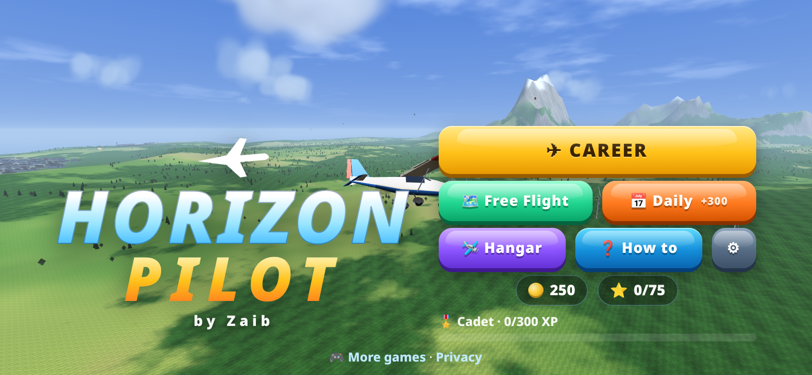
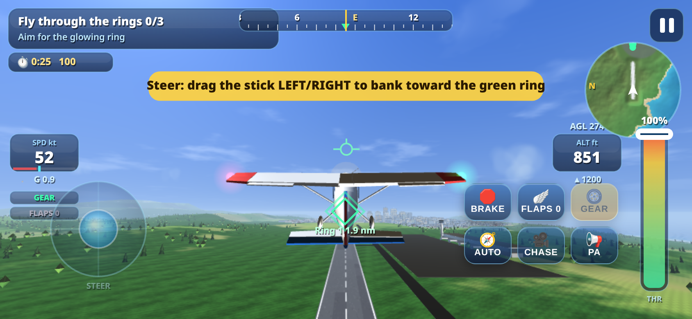
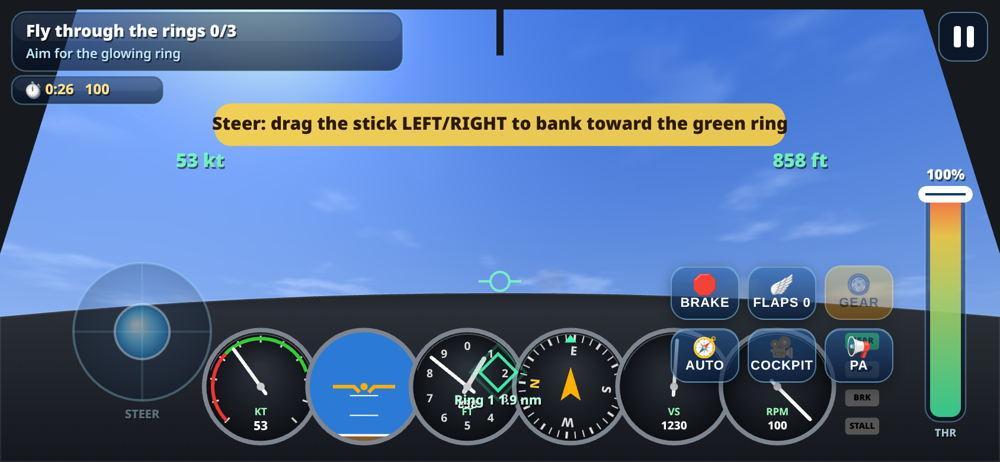
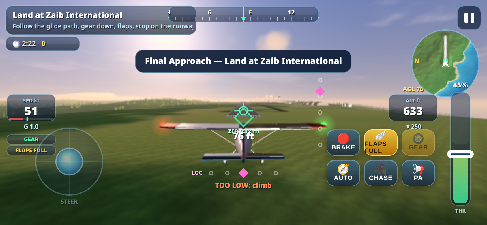

# Horizon Pilot by Zaib

A premium 3D flight game for mobile and desktop browsers, written in raw WebGL in one self-contained `index.html` with no libraries.

**Play:** https://zaibgames.com/horizon-pilot/

## Features
- A 3D island world: procedural terrain, ocean, cities, 7 airports with runway lights and PAPI, and clouds.
- Day, dusk and night lighting, plus storm weather.
- An arcade-sim flight model with auto-level assist. Loops, rolls, knife-edge and inverted flight are all possible.
- 7 aircraft built from primitives: Sparrow trainer, Bumblebee biplane, Pelican floatplane, Hornet aerobatic, Falcon business jet, Atlas airliner and Viper fighter. Gear, propellers and control surfaces are animated.
- A career of 25 missions: rings, landings, water landings, cargo drops, firefighting, sea rescue, stunts, engine-out, gear jam, night, storm and jets.
- Free Flight with 30 hidden golden stars, plus a Daily Challenge with a streak bonus.
- Coins, XP and ranks, plane upgrades, liveries and smoke colours.
- Three camera modes: chase, cockpit (with instruments) and cinematic.
- Synthesized engine, wind and sound effects, and particles.
- Automatic quality scaling. The game pauses when the tab is hidden, and progress is saved in localStorage.

## Controls
- **Touch:** left virtual stick to steer and pitch (or phone tilt), right slider for throttle, plus buttons for brake, flaps, gear, auto, camera and action.
- **Keyboard:** Arrows/WASD to steer, Shift/Ctrl or R/F for throttle, G for gear, V for flaps, B for brake, Q/E for rudder, C for camera, Space for action, P/Esc to pause.

Game by Zaib · [More games](https://zaibgames.com/) · [Privacy](https://zaibgames.com/privacy/)
